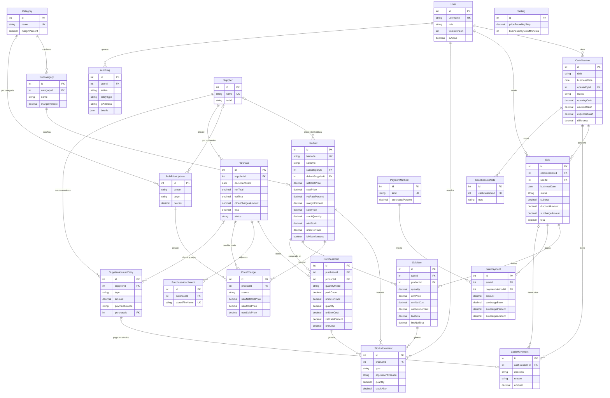

# Modelo de datos – Kiosco (versión 1)

> **Estado:** borrador para aprobación (Fase 2), con las respuestas de la Ronda 7 y del cliente incorporadas. Basado en `docs/requisitos.md`.
> Los puntos que dependen de algo sin decidir están marcados con **H-xx** (ver `requisitos.md`, secciones 7.2 y 7.4). El modelo está pensado para que esas respuestas **no cambien tablas**: como mucho cambian un cálculo o un `CHECK`.
> Base de datos: PostgreSQL. ORM: Prisma. El esquema real (`schema.prisma`) lo escribe el agente `base-datos` a partir de este documento.

---

## 1. Convenciones

### 1.1 Dinero: `Decimal` de Prisma (`numeric(14,2)` en PostgreSQL)

**Decisión:** todo importe de dinero (precios, costos, totales, pagos, saldos) es `Decimal @db.Decimal(14, 2)`: pesos con 2 decimales, hasta 999.999.999.999,99.

**Por qué no centavos enteros:** con la inflación, un total mensual en centavos pasa rápido el límite de `Int` de Prisma (2.147.483.647 centavos = $21 millones), y usar `BigInt` complica el JSON y el código. `numeric` es exacto, se lee directo en la base y en Excel ("1440.00", no "144000"), y Prisma lo maneja con `Prisma.Decimal`.
**Contra:** en el código no se puede usar `+` ni `*` con números de JS: hay que usar los métodos de `Prisma.Decimal` (`.add()`, `.mul()`). Regla para el backend: **nunca convertir dinero a `number`**.

**Tres redondeos distintos, cada uno en una sola función compartida:**

| Redondeo | Dónde | Regla |
|---|---|---|
| Técnico, a centavos | Cálculos intermedios (costo por unidad de un bulto, neto sin IVA, reparto del descuento) | 2 decimales, "mitad hacia arriba" (`ROUND_HALF_UP`). |
| Al cobrar, a pesos enteros | Importe de cada línea de venta, descuento, recargo (PA-20) | Peso entero. Dirección pendiente de **H-06** (propuesto: al más cercano). |
| Comercial, de precios | Precio sugerido (margen, compras, aumentos masivos) | Siempre **hacia arriba** al múltiplo de `Setting.priceRoundingStep` ($10) (PA-19). |

Los importes que componen lo cobrado (líneas, descuento, recargo) quedan en pesos enteros aunque la columna admita centavos; los costos y netos sí pueden tener centavos.

### 1.2 Cantidades: `Decimal(12,3)` para todo

**Decisión:** stock y cantidades (ventas, compras, movimientos, mínimos, unidades por bulto) usan `Decimal @db.Decimal(12, 3)`. Un producto **por unidad** guarda números enteros (`2.000`); uno **por peso** guarda kg con hasta 3 decimales (`0.350` = 350 g).
**Por qué:** un solo tipo para las dos unidades evita tener dos columnas o dos tablas. Que un producto por unidad tenga siempre cantidades enteras lo valida el backend (un `CHECK` no puede mirar la unidad del producto en otra tabla).

### 1.3 Porcentajes e IVA

Márgenes, recargos y aumentos: `Decimal @db.Decimal(6, 2)` (ej.: `40.00` = 40%).
Alícuota de IVA: `Decimal @db.Decimal(5, 2)` (ej.: `21.00`, `10.50`). Los valores permitidos (0; 2,5; 5; 10,5; 21; 27, que son las alícuotas que usa ARCA) se validan en el código compartido; en la base, `CHECK (>= 0 AND <= 100)`.

### 1.4 Precios con IVA, costos neto y final

El kiosco es **responsable inscripto** (PA-13):
- El **precio de venta** se guarda **final**, con IVA incluido (es lo que paga el cliente).
- Los **costos** se guardan **dos veces**: **neto** (sin IVA) y **final** (neto + IVA de la factura de compra). En las compras se carga neto + % IVA y el sistema calcula el final.
- La **ganancia** se calcula sobre el **neto**: importe neto vendido − costo neto.
- Sobre qué costo se aplica el margen (neto o final) está pendiente de **H-15**. No cambia tablas: solo la fórmula del precio sugerido.

### 1.5 Día de trabajo

El kiosco tiene tres turnos y el de noche pasa la medianoche (PA-32). Cada venta y cada caja guardan su **día de trabajo** (`businessDate`, tipo `Date`), calculado **al guardar**:
`businessDate = fecha (hora de Buenos Aires − hora de corte)`. Con corte 06:00, una venta del martes a las 02:30 queda en el lunes.
La hora de corte está en `Setting.businessDayCutoffMinutes` (360 = 06:00). Si el dueño la cambia, los registros viejos **mantienen** su día (los reportes pasados no se mueven).

### 1.6 Otras convenciones

| Tema | Convención |
|---|---|
| Nombres | Modelos Prisma en `PascalCase` singular y campos en `camelCase` (como se listan acá). En PostgreSQL, tablas y columnas en `snake_case` (plural para tablas) usando `@@map` / `@map`. Ej.: `SaleItem.unitPrice` → `sale_items.unit_price`. |
| Claves primarias | `id Int @id @default(autoincrement())`. El `id` de la venta sirve como **número de venta**. |
| Fechas y horas | `DateTime @db.Timestamptz(3)`. Zona horaria `America/Argentina/Buenos_Aires` (en `.env`). Fechas sin hora (día de trabajo, fecha de factura): `@db.Date`. |
| Creación / modificación | `createdAt` en todas las tablas; `updatedAt` en las que se editan. |
| Borrado lógico | Datos maestros (productos, categorías, subcategorías, proveedores, usuarios, medios de pago) **no se borran**: tienen `isActive`. Las operaciones (ventas, compras) **nunca se borran**: se **anulan** con `status = VOIDED`. |
| Claves foráneas | `onDelete: Restrict` por defecto. Toda columna FK lleva índice (PostgreSQL no lo crea solo). |
| `CHECK` e índices parciales | Prisma no los declara en el esquema: el agente `base-datos` los agrega a mano en el SQL de la migración. Están listados en cada tabla. |
| JSON de la API | Dinero, cantidades y porcentajes viajan como **string** (`"1440.00"`, `"0.350"`, `"21.00"`). El frontend los formatea en es-AR. |
| Enums | `enum` de Prisma para listas cortas y estables. La acción de auditoría es `String` con su lista en el código compartido. |

---

## 2. Entidades

Leyenda: **Oblig.** = obligatorio (`NOT NULL`). "→ X" = clave foránea a la tabla X.

### 2.1 `User` (users) — usuarios

| Campo | Tipo | Oblig. | Descripción |
|---|---|:---:|---|
| id | Int | ✅ | |
| username | String | ✅ | Nombre de usuario para el login, en minúsculas. **Único.** |
| fullName | String | ✅ | Nombre y apellido para mostrar. |
| passwordHash | String | ✅ | Contraseña cifrada con bcrypt. Nunca se devuelve en la API. |
| role | `UserRole` | ✅ | `OWNER` (dueño), `MANAGER` (encargado), `EMPLOYEE` (empleado). Puede haber varios `OWNER` (PA-37). |
| isActive | Boolean | ✅ | `false` = desactivado (no puede entrar). Default `true`. |
| tokenVersion | Int | ✅ | Default 0. Se incrementa al cambiar o resetear la contraseña o al desactivar el usuario, para invalidar sesiones abiertas (por ejemplo, si se pierde un celular con acceso remoto). |
| lastLoginAt | DateTime | | Último ingreso. |
| createdAt / updatedAt | DateTime | ✅ | |

Restricciones: `UNIQUE(username)`. La sesión dura hasta 12 h (PA-37): es la duración del JWT, no un campo.

### 2.2 `Setting` (settings) — configuración general

Tabla de **una sola fila** (`id = 1`), con columnas tipadas. Solo la edita el dueño.

| Campo | Tipo | Oblig. | Descripción |
|---|---|:---:|---|
| id | Int | ✅ | Siempre 1. `CHECK (id = 1)`. |
| storeName | String | ✅ | Nombre del negocio. |
| priceRoundingStep | Decimal(14,2) | ✅ | De a cuánto se redondean los precios, **siempre hacia arriba** (PA-19). Default `10.00`. `0` = sin redondeo. `CHECK (>= 0)`. |
| businessDayCutoffMinutes | Int | ✅ | Hora de corte del día de trabajo, en minutos desde las 00:00. Default `360` (06:00). `CHECK (BETWEEN 0 AND 1439)`. (PA-32) |
| updatedAt | DateTime | ✅ | |
| updatedById | Int → User | | Quién la cambió por última vez. |

Los recargos están en `PaymentMethod` y los márgenes en `Category`, `Subcategory` y `Product`. Lo técnico (rutas de backups y adjuntos, zona horaria) va en `.env` (sección 6).

### 2.3 `PaymentMethod` (payment_methods) — medios de pago y recargos

| Campo | Tipo | Oblig. | Descripción |
|---|---|:---:|---|
| id | Int | ✅ | |
| kind | `PaymentMethodKind` | ✅ | `CASH`, `TRANSFER`, `QR`, `DEBIT_CARD`, `CREDIT_CARD`. **Único.** El sistema usa `CASH` para el arqueo. |
| name | String | ✅ | Nombre visible (ej.: "QR Mercado Pago"). |
| surchargePercent | Decimal(6,2) | ✅ | % de recargo. Default 0. `CHECK (>= 0)`. Crédito ≈ 10% (un único %, sin cuotas, PA-12); el resto 0. |
| isActive | Boolean | ✅ | |
| sortOrder | Int | ✅ | Orden en la pantalla de cobro. |
| updatedAt | DateTime | ✅ | |

Restricciones: `UNIQUE(kind)`.

### 2.4 `Category` (categories) — categorías

| Campo | Tipo | Oblig. | Descripción |
|---|---|:---:|---|
| id | Int | ✅ | |
| name | String | ✅ | Ej.: "Bebidas". **Único.** |
| marginPercent | Decimal(6,2) | ✅ | Margen de la categoría: el **último** de la cadena producto → subcategoría → categoría, por eso es obligatorio. `CHECK (>= 0)`. Solo lo cambia el dueño (PA-33). |
| isActive | Boolean | ✅ | |
| createdAt / updatedAt | DateTime | ✅ | |

Crean y editan categorías el encargado y el dueño (PA-33).

### 2.5 `Subcategory` (subcategories) — subcategorías

| Campo | Tipo | Oblig. | Descripción |
|---|---|:---:|---|
| id | Int | ✅ | |
| categoryId | Int → Category | ✅ | Categoría a la que pertenece. |
| name | String | ✅ | Ej.: "Gaseosas". |
| marginPercent | Decimal(6,2) | | Margen propio. `NULL` = usa el de la categoría (PA-22). `CHECK (>= 0)`. Solo lo cambia el dueño (PA-33). |
| isActive | Boolean | ✅ | |
| createdAt / updatedAt | DateTime | ✅ | |

Restricciones: `UNIQUE(categoryId, name)` (sirve también como índice de `categoryId`).

**Margen que se usa** = `Product.marginPercent` ?? `Subcategory.marginPercent` ?? `Category.marginPercent`.

### 2.6 `Supplier` (suppliers) — proveedores

| Campo | Tipo | Oblig. | Descripción |
|---|---|:---:|---|
| id | Int | ✅ | |
| name | String | ✅ | **Único.** |
| phone | String | | Teléfono / WhatsApp (solo dígitos, con código de país, para armar el link de WhatsApp). |
| email | String | | |
| taxId | String | | CUIT, 11 dígitos sin guiones. `CHECK (tax_id ~ '^[0-9]{11}$')`. |
| visitDays | `Weekday[]` | ✅ | Días de visita (`MON`…`SUN`). Default lista vacía. |
| notes | String | | |
| isActive | Boolean | ✅ | |
| createdAt / updatedAt | DateTime | ✅ | |

El **saldo** de la cuenta corriente no se guarda acá: se calcula sumando `SupplierAccountEntry` (2.20).

### 2.7 `Product` (products) — productos

| Campo | Tipo | Oblig. | Descripción |
|---|---|:---:|---|
| id | Int | ✅ | |
| name | String | ✅ | Nombre para buscar y mostrar. |
| barcode | String | | Código de barras. Uno por producto (PA-11). **Único** cuando existe. |
| saleUnit | `SaleUnit` | ✅ | `UNIT` (por unidad) o `KG` (por peso). |
| subcategoryId | Int → Subcategory | ✅ | Subcategoría fija. La categoría sale de la subcategoría. |
| defaultSupplierId | Int → Supplier | | Proveedor habitual, uno (PA-04). |
| netCostPrice | Decimal(14,2) | ✅ | **Costo neto** actual (sin IVA), por unidad o por kg. Es el **último** pagado (PA-05). Default 0. `CHECK (>= 0)`. |
| costPrice | Decimal(14,2) | ✅ | **Costo final** actual (neto + IVA de la última compra). Default 0. `CHECK (cost_price >= net_cost_price)`. |
| vatRatePercent | Decimal(5,2) | ✅ | **IVA de venta** del producto. Default `21.00`, editable (PA-13). No cambia lo que se cobra; se usa para la ganancia neta y para ARCA a futuro. |
| marginPercent | Decimal(6,2) | | Margen propio. `NULL` = usa el de la subcategoría o la categoría. `CHECK (>= 0)`. Quién lo cambia: H-05. |
| salePrice | Decimal(14,2) | ✅ | **Precio de venta final** (con IVA), por unidad o por kg. Se **guarda**; el margen solo **sugiere** (PA-21). `CHECK (>= 0)`. |
| stockQuantity | Decimal(12,3) | ✅ | Stock actual. **Puede ser negativo** (R2). Default 0. Resumen de `StockMovement` (D4). |
| minStock | Decimal(12,3) | ✅ | Stock mínimo. Default 0. `CHECK (>= 0)`. |
| unitsPerPack | Decimal(12,3) | | **Unidades por bulto sugeridas** para cargar compras (PA-06). `CHECK (> 0)`. Si se actualiza con el último valor usado en una compra: H-07. |
| isMiscellaneous | Boolean | ✅ | `true` solo para el producto especial **"Varios"** (PA-10): precio escrito a mano al vender, **sin stock**. Default `false`. |
| isActive | Boolean | ✅ | |
| createdAt / updatedAt | DateTime | ✅ | |

Restricciones e índices:
- `UNIQUE(barcode)` (PostgreSQL permite varios `NULL`).
- Un solo "Varios": `CREATE UNIQUE INDEX ON products (is_miscellaneous) WHERE is_miscellaneous;`
- `CHECK (vat_rate_percent >= 0 AND vat_rate_percent <= 100)`.
- Índices: `subcategoryId`, `defaultSupplierId`.
- Búsqueda por nombre: al principio `ILIKE` alcanza. Si se vuelve lento, índice de trigramas (`pg_trgm`) sobre `lower(name)` y búsqueda sin acentos (`unaccent`).
- "Para reponer": `stockQuantity <= minStock` sobre productos activos y no "Varios" (PA-26).

El producto "Varios" se crea en la instalación (seed), en una categoría y subcategoría "Varios" (propuesto en H-09), con costo 0.

### 2.8 `StockMovement` (stock_movements) — historial de stock

Cada cambio de stock es una fila. **Nunca se edita ni se borra.** El producto "Varios" no genera movimientos.

| Campo | Tipo | Oblig. | Descripción |
|---|---|:---:|---|
| id | Int | ✅ | |
| productId | Int → Product | ✅ | |
| type | `StockMovementType` | ✅ | `SALE`, `SALE_VOID`, `PURCHASE`, `PURCHASE_VOID`, `ADJUSTMENT`. |
| quantity | Decimal(12,3) | ✅ | Con signo: `+` entra, `−` sale. `CHECK (quantity <> 0)`. |
| stockAfter | Decimal(12,3) | ✅ | Stock que quedó después del movimiento. |
| unitNetCost | Decimal(14,2) | | Costo neto del producto en ese momento (para valorizar roturas, faltantes o consumo propio). |
| adjustmentReason | `StockAdjustmentReason` | | Solo en ajustes (PA-27): `BREAKAGE` (rotura), `MISSING` (faltante: robo o pérdida), `COUNT_CORRECTION` (corrección por conteo), `INITIAL_LOAD` (carga inicial), `OWN_CONSUMPTION` (consumo propio), `OTHER`. |
| note | String | | Obligatoria si el motivo es `OTHER`. |
| saleItemId | Int → SaleItem | | Línea de venta que lo generó. |
| purchaseItemId | Int → PurchaseItem | | Línea de compra que lo generó. |
| userId | Int → User | ✅ | Quién lo hizo. |
| createdAt | DateTime | ✅ | |

`CHECK`s:
- `type = 'ADJUSTMENT'` ⇔ `adjustment_reason IS NOT NULL`.
- `adjustment_reason = 'OTHER'` ⇒ `note IS NOT NULL`.
- `type IN ('SALE','SALE_VOID')` ⇒ `sale_item_id IS NOT NULL`; `type IN ('PURCHASE','PURCHASE_VOID')` ⇒ `purchase_item_id IS NOT NULL`.
- `SALE` y `PURCHASE_VOID` con `quantity < 0`; `SALE_VOID` y `PURCHASE` con `quantity > 0`.

Índices: `(productId, createdAt)`, `createdAt`, `saleItemId`, `purchaseItemId`, `userId`.

### 2.9 `PriceChange` (price_changes) — historial de costos y precios

Una fila cada vez que cambia el costo (neto o final), el precio o el margen propio de un producto.

| Campo | Tipo | Oblig. | Descripción |
|---|---|:---:|---|
| id | Int | ✅ | |
| productId | Int → Product | ✅ | |
| source | `PriceChangeSource` | ✅ | `MANUAL`, `PURCHASE`, `BULK_UPDATE`, `IMPORT`. |
| oldNetCostPrice / newNetCostPrice | Decimal(14,2) | ✅ | Costo neto antes y después. |
| oldCostPrice / newCostPrice | Decimal(14,2) | ✅ | Costo final antes y después. |
| oldSalePrice / newSalePrice | Decimal(14,2) | ✅ | Precio de venta (final) antes y después. |
| oldMarginPercent / newMarginPercent | Decimal(6,2) | | Margen propio antes y después (`NULL` = usaba / usa el heredado). |
| purchaseId | Int → Purchase | | Si vino de una compra. |
| bulkPriceUpdateId | Int → BulkPriceUpdate | | Si vino de un aumento masivo. |
| userId | Int → User | ✅ | |
| createdAt | DateTime | ✅ | |

`CHECK`: `source = 'PURCHASE'` ⇒ `purchase_id IS NOT NULL`; `source = 'BULK_UPDATE'` ⇒ `bulk_price_update_id IS NOT NULL`.
Índices: `(productId, createdAt)`, `createdAt`, `purchaseId`, `bulkPriceUpdateId`.
Los cambios de IVA del producto se registran en `AuditLog` (no afectan precios).

### 2.10 `BulkPriceUpdate` (bulk_price_updates) — aumentos masivos

Cabecera de cada aumento; el detalle por producto queda en `PriceChange`.

| Campo | Tipo | Oblig. | Descripción |
|---|---|:---:|---|
| id | Int | ✅ | |
| scope | `BulkUpdateScope` | ✅ | `SUPPLIER` o `CATEGORY`. |
| supplierId | Int → Supplier | | Obligatorio si `scope = SUPPLIER`. |
| categoryId | Int → Category | | Obligatorio si `scope = CATEGORY`. |
| target | `BulkUpdateTarget` | ✅ | Elegido en cada aumento (PA-23): `COST` (sube costo neto y final en el mismo %, y el precio se recalcula con margen y redondeo) o `SALE_PRICE` (sube el precio y se redondea). |
| percent | Decimal(6,2) | ✅ | `CHECK (percent > 0)`: **solo aumentos** (PA-23). |
| productsAffected | Int | ✅ | Cantidad de productos modificados. |
| userId | Int → User | ✅ | |
| createdAt | DateTime | ✅ | |

`CHECK`: `(scope = 'SUPPLIER' AND supplier_id IS NOT NULL AND category_id IS NULL) OR (scope = 'CATEGORY' AND category_id IS NOT NULL AND supplier_id IS NULL)`.
La vista previa no se guarda: se calcula, se muestra y solo al confirmar se crea el registro.

### 2.11 `CashSession` (cash_sessions) — caja por turno

| Campo | Tipo | Oblig. | Descripción |
|---|---|:---:|---|
| id | Int | ✅ | |
| shift | `Shift` | ✅ | Turno: `MORNING` (Mañana), `AFTERNOON` (Tarde), `NIGHT` (Noche). Se elige al abrir (PA-32). |
| businessDate | Date | ✅ | Día de trabajo, calculado con `openedAt` y la hora de corte (1.5). |
| openedById | Int → User | ✅ | Quién abrió. |
| openedAt | DateTime | ✅ | |
| openingCash | Decimal(14,2) | ✅ | Efectivo inicial, lo escribe quien abre (PA-30). `CHECK (>= 0)`. |
| status | `CashSessionStatus` | ✅ | `OPEN` o `CLOSED`. |
| closedById | Int → User | | Quién cerró (puede no ser quien abrió: H-04). |
| closedAt | DateTime | | |
| countedCash | Decimal(14,2) | | Efectivo contado a ciegas (solo efectivo, PA-28). |
| expectedCash | Decimal(14,2) | | Efectivo esperado, **calculado y guardado al cerrar** (foto fija). |
| difference | Decimal(14,2) | | `countedCash − expectedCash`. Negativo = faltante. La API solo lo muestra a encargado y dueño; solo se informa (PA-30). |
| closingNote | String | | Nota de quien cierra. |
| createdAt / updatedAt | DateTime | ✅ | |

`CHECK`: si `status = 'CLOSED'` ⇒ `closed_at`, `closed_by_id`, `counted_cash`, `expected_cash` y `difference` no nulos; si `OPEN` ⇒ todos nulos.

**Una sola caja abierta en todo el kiosco** (PA-02), con índice único parcial en el SQL de la migración:
`CREATE UNIQUE INDEX cash_sessions_single_open ON cash_sessions ((true)) WHERE status = 'OPEN';`
Si dos personas intentan abrir caja a la vez, la base rechaza la segunda.

Cálculo al cerrar (en una transacción):
`expectedCash = openingCash + Σ (amount + surchargeAmount) de los pagos en efectivo de las ventas de esta caja + Σ CashMovement IN − Σ CashMovement OUT`.
Las ventas anuladas **siguen contando** acá: su devolución en efectivo es un `CashMovement` de salida (`SALE_VOID_REFUND`) en la caja abierta al anular (PA-17). Así una caja cerrada nunca cambia.

Índices: `cash_sessions_single_open`, `businessDate`, `(openedById, openedAt)`.

### 2.12 `CashSessionNote` (cash_session_notes) — notas agregadas a un cierre

Un cierre no se corrige; solo se le **agregan notas** (PA-30). Solo se agregan filas.

| Campo | Tipo | Oblig. | Descripción |
|---|---|:---:|---|
| id | Int | ✅ | |
| cashSessionId | Int → CashSession | ✅ | |
| note | String | ✅ | |
| userId | Int → User | ✅ | Encargado o dueño (Propuesta: los que ven la diferencia). |
| createdAt | DateTime | ✅ | |

Índice: `cashSessionId`.

### 2.13 `CashMovement` (cash_movements) — ingresos y salidas de efectivo

Los registran encargado y dueño (PA-29), nunca desde afuera del local (PA-01).

| Campo | Tipo | Oblig. | Descripción |
|---|---|:---:|---|
| id | Int | ✅ | |
| cashSessionId | Int → CashSession | ✅ | Caja abierta en la que se registró. |
| direction | `CashDirection` | ✅ | `IN` (ingreso) u `OUT` (salida). |
| reason | `CashMovementReason` | ✅ | (PA-29) `SUPPLIER_PAYMENT` (pago a proveedor), `OWNER_WITHDRAWAL` (retiro del dueño), `EXPENSE` (gasto), `CASH_CONTRIBUTION` (aporte de cambio), `SALE_VOID_REFUND` (devolución por anulación), `OTHER`. |
| description | String | ✅ | Detalle escrito por el usuario (ej.: "Pago luz"). |
| amount | Decimal(14,2) | ✅ | Siempre positivo; el sentido lo da `direction`. `CHECK (amount > 0)`. |
| supplierAccountEntryId | Int → SupplierAccountEntry | | Si es un pago a proveedor. **Único.** |
| saleId | Int → Sale | | Si es la devolución de una venta anulada. |
| userId | Int → User | ✅ | Quién lo registró. |
| createdAt | DateTime | ✅ | |

`CHECK`s (sentido de cada motivo):
- `SUPPLIER_PAYMENT` ⇒ `direction = 'OUT' AND supplier_account_entry_id IS NOT NULL`.
- `SALE_VOID_REFUND` ⇒ `direction = 'OUT' AND sale_id IS NOT NULL`.
- `OWNER_WITHDRAWAL`, `EXPENSE` ⇒ `direction = 'OUT'`.
- `CASH_CONTRIBUTION` ⇒ `direction = 'IN'`.
- `OTHER` ⇒ cualquiera de los dos.

Índices: `cashSessionId`, `createdAt`, `saleId`, `userId`; `UNIQUE(supplierAccountEntryId)`.

### 2.14 `Sale` (sales) — ventas

| Campo | Tipo | Oblig. | Descripción |
|---|---|:---:|---|
| id | Int | ✅ | También es el **número de venta**. |
| cashSessionId | Int → CashSession | ✅ | La caja abierta (única) al momento de cobrar. |
| userId | Int → User | ✅ | Quién vendió (cualquier usuario, PA-02). |
| businessDate | Date | ✅ | Día de trabajo, calculado con `createdAt` y la hora de corte (1.5). |
| status | `SaleStatus` | ✅ | `COMPLETED` o `VOIDED` (anulada). |
| subtotal | Decimal(14,2) | ✅ | Suma de `lineSubtotal` (pesos enteros). |
| discountAmount | Decimal(14,2) | ✅ | Descuento manual sobre el total, en $ (pesos enteros). Default 0. (PA-15) |
| discountPercent | Decimal(6,2) | | Si el descuento se cargó en %, el % usado (informativo). |
| discountReason | String | | Motivo opcional. |
| surchargeAmount | Decimal(14,2) | ✅ | Suma de los recargos de los pagos. Default 0. |
| total | Decimal(14,2) | ✅ | Lo cobrado: `subtotal − discountAmount + surchargeAmount`. |
| voidedAt | DateTime | | |
| voidedById | Int → User | | Quién anuló (encargado o dueño). |
| voidReason | String | | Motivo de la anulación. |
| createdAt | DateTime | ✅ | Fecha y hora de la venta. |

`CHECK`s:
- `discount_amount >= 0 AND discount_amount <= subtotal` (si el descuento del 100% se prohíbe, H-10, pasa a `<`).
- `surcharge_amount >= 0`.
- `total = subtotal - discount_amount + surcharge_amount`.
- `status = 'VOIDED'` ⇔ (`voided_at`, `voided_by_id` y `void_reason` no nulos).

Índices: `businessDate` (reportes), `createdAt`, `cashSessionId`, `(userId, createdAt)`, `voidedById`.

### 2.15 `SaleItem` (sale_items) — líneas de venta (con "foto" de precio, costo e IVA)

| Campo | Tipo | Oblig. | Descripción |
|---|---|:---:|---|
| id | Int | ✅ | |
| saleId | Int → Sale | ✅ | |
| productId | Int → Product | ✅ | |
| productName | String | ✅ | Nombre del producto **al vender**. |
| customDescription | String | | Solo "Varios": qué se vendió (opcional, propuesto en H-09). |
| saleUnit | `SaleUnit` | ✅ | Unidad al vender. |
| quantity | Decimal(12,3) | ✅ | `CHECK (quantity > 0)`. Peso escrito a mano para productos por kg (PA-09). |
| unitPrice | Decimal(14,2) | ✅ | Precio final **congelado** al vender (en "Varios", el escrito a mano). |
| unitNetCost | Decimal(14,2) | ✅ | Costo neto **congelado** al vender (0 en "Varios"). Base de la ganancia. |
| unitCost | Decimal(14,2) | ✅ | Costo final **congelado** al vender (por si H-17 elige valorizar con costo final). |
| vatRatePercent | Decimal(5,2) | ✅ | IVA del producto **congelado** al vender. |
| lineSubtotal | Decimal(14,2) | ✅ | `quantity × unitPrice`, redondeado al **peso entero** (PA-20, H-06). |
| discountAmount | Decimal(14,2) | ✅ | Parte del descuento de la venta que le toca a esta línea (reparto proporcional, D6). Default 0. |
| lineTotal | Decimal(14,2) | ✅ | `lineSubtotal − discountAmount`. Lo cobrado por esta línea, **con IVA** y sin recargo. |
| lineNetTotal | Decimal(14,2) | ✅ | `lineTotal ÷ (1 + vatRatePercent/100)`, a centavos. Lo cobrado **sin IVA**. Base de la ganancia y de ARCA. |

`CHECK`s: `unit_price >= 0`, `unit_net_cost >= 0`, `unit_cost >= unit_net_cost`, `discount_amount >= 0`, `line_total = line_subtotal - discount_amount`, `line_net_total <= line_total`.
Índices: `saleId`, `productId`.

**Ganancia de la línea** (PA-13, PA-31) = `lineNetTotal − quantity × unitNetCost`. El recargo no entra.
Ejemplo: se cobran $1.210 por un producto con IVA 21% y costo neto $700 → `lineNetTotal` = $1.000 → ganancia $300.

### 2.16 `SalePayment` (sale_payments) — pagos de la venta (pago mixto y recargo)

Una venta tiene **uno o más** pagos (ninguno solo si el total es $0, H-10).

| Campo | Tipo | Oblig. | Descripción |
|---|---|:---:|---|
| id | Int | ✅ | |
| saleId | Int → Sale | ✅ | |
| paymentMethodId | Int → PaymentMethod | ✅ | |
| amount | Decimal(14,2) | ✅ | Parte de la venta (ya con el descuento) que cubre este pago, **sin** recargo. `CHECK (amount > 0)`. |
| surchargeBase | Decimal(14,2) | ✅ | Lo que valía esta parte **antes del descuento**: `amount × subtotal ÷ (subtotal − discountAmount)`, a centavos. Igual a `amount` si no hubo descuento. |
| surchargePercent | Decimal(6,2) | ✅ | % de recargo del medio de pago, **congelado** al vender (0 salvo crédito). |
| surchargeAmount | Decimal(14,2) | ✅ | `surchargeBase × surchargePercent / 100`, redondeado al **peso entero**. `CHECK (>= 0)`. |

**Regla del recargo (PA-14): se calcula antes del descuento y solo sobre la parte pagada con crédito.**
Ejemplo (pago mixto): subtotal $10.000, descuento $1.000 → quedan $9.000.

| Pago | amount | surchargeBase | % | surchargeAmount | Se cobra |
|---|---:|---:|---:|---:|---:|
| Efectivo | 4.500 | 5.000 | 0 | 0 | 4.500 |
| Crédito | 4.500 | 5.000 | 10 | 500 | 5.000 (en el posnet) |
| **Venta** | 9.000 | | | **500** | **9.500** = `Sale.total` |

Con todo en crédito: `amount` 9.000 → `surchargeBase` 10.000 → recargo 1.000 → total $10.000. (El reparto proporcional en pago mixto se valida con el dueño: H-11.)

Reglas que valida el backend en la transacción (cruzan filas, no se pueden poner en un `CHECK`): `Σ amount = subtotal − discountAmount` y `Σ surchargeAmount = sale.surchargeAmount`.
Índices: `saleId`, `paymentMethodId`.

### 2.17 `Purchase` (purchases) — compras

| Campo | Tipo | Oblig. | Descripción |
|---|---|:---:|---|
| id | Int | ✅ | |
| supplierId | Int → Supplier | ✅ | |
| documentType | `PurchaseDocumentType` | ✅ | `INVOICE` (factura), `DELIVERY_NOTE` (remito), `OTHER`. |
| documentNumber | String | | Número de factura/remito. |
| documentDate | Date | ✅ | Fecha del comprobante. |
| netTotal | Decimal(14,2) | ✅ | Suma de `lineNetTotal`. |
| vatTotal | Decimal(14,2) | ✅ | Suma del IVA de las líneas (`lineTotal − lineNetTotal`). |
| otherChargesAmount | Decimal(14,2) | ✅ | Percepciones, flete u otros cargos que suman a la deuda pero **no** al costo de los productos. Default 0. **Se usa solo si H-16 elige la opción a)**; si no, queda siempre en 0. `CHECK (>= 0)`. |
| total | Decimal(14,2) | ✅ | Lo que se le debe al proveedor: `netTotal + vatTotal + otherChargesAmount`. |
| notes | String | | |
| status | `PurchaseStatus` | ✅ | `CONFIRMED` o `VOIDED`. Una compra mal cargada se anula y se carga de nuevo; no se edita (PA-25). |
| userId | Int → User | ✅ | Quién la cargó. |
| voidedAt / voidedById / voidReason | | | Igual que en `Sale`. |
| createdAt | DateTime | ✅ | |

`CHECK`s: `total = net_total + vat_total + other_charges_amount`; `status = 'VOIDED'` ⇔ campos de anulación no nulos.
Índices: `(supplierId, documentDate)`, `documentDate`, `(supplierId, documentNumber)` (para **avisar** si se carga dos veces la misma factura; no es único porque los remitos pueden repetir número).

### 2.18 `PurchaseItem` (purchase_items) — líneas de compra (por unidad o por bulto, neto + IVA)

Se guarda **lo que se cargó** (bultos o unidades) y también lo **convertido a unidades de venta**, que es lo que mueve stock y costos.

| Campo | Tipo | Oblig. | Descripción |
|---|---|:---:|---|
| id | Int | ✅ | |
| purchaseId | Int → Purchase | ✅ | |
| productId | Int → Product | ✅ | |
| quantityMode | `PurchaseQuantityMode` | ✅ | `UNIT` (por unidad o kg) o `PACK` (por bulto), elegido en cada línea (PA-06). |
| packCount | Decimal(12,3) | | Solo `PACK`: cantidad de bultos. `CHECK (> 0)`. |
| unitsPerPack | Decimal(12,3) | | Solo `PACK`: unidades por bulto **en esta compra** (sugeridas desde el producto, editables). `CHECK (> 0)`. |
| packNetCost | Decimal(14,2) | | Solo `PACK`: costo neto de un bulto. `CHECK (>= 0)`. |
| quantity | Decimal(12,3) | ✅ | Cantidad en **unidades de venta** (o kg). En `PACK` = `packCount × unitsPerPack`. `CHECK (> 0)`. |
| unitNetCost | Decimal(14,2) | ✅ | Costo neto por unidad. En `PACK` = `packNetCost ÷ unitsPerPack` (a centavos). `CHECK (>= 0)`. |
| vatRatePercent | Decimal(5,2) | ✅ | IVA de esta línea según la factura (sugerido desde el producto; 0 si la factura no discrimina IVA). |
| unitCost | Decimal(14,2) | ✅ | Costo final por unidad = `unitNetCost × (1 + vatRatePercent/100)`. Lo calcula el sistema. |
| lineNetTotal | Decimal(14,2) | ✅ | En `UNIT` = `quantity × unitNetCost`; en `PACK` = `packCount × packNetCost` (así coincide con la factura aunque el costo por unidad tenga redondeo). |
| lineTotal | Decimal(14,2) | ✅ | `lineNetTotal × (1 + vatRatePercent/100)`, a centavos. |
| previousNetCostPrice | Decimal(14,2) | ✅ | Costo neto que tenía el producto antes (para el aviso "subió X%"). |
| previousCostPrice | Decimal(14,2) | ✅ | Costo final que tenía el producto antes. |

`CHECK`s:
- `quantity_mode = 'PACK'` ⇔ (`pack_count`, `units_per_pack` y `pack_net_cost` no nulos).
- `quantity_mode = 'PACK'` ⇒ `quantity = pack_count * units_per_pack`.
- `vat_rate_percent BETWEEN 0 AND 100`; `line_total >= line_net_total`.

Índices: `purchaseId`, `productId`.

### 2.19 `PurchaseAttachment` (purchase_attachments) — fotos/archivos de la factura

Los archivos se guardan **en disco** (carpeta `UPLOADS_DIR` de `.env`), no dentro de la base.

| Campo | Tipo | Oblig. | Descripción |
|---|---|:---:|---|
| id | Int | ✅ | |
| purchaseId | Int → Purchase | ✅ | |
| originalFileName | String | ✅ | Nombre con el que se subió. |
| storedFileName | String | ✅ | Nombre generado por el sistema (aleatorio). **Único.** |
| mimeType | String | ✅ | `image/jpeg`, `image/png` o `application/pdf`. |
| sizeBytes | Int | ✅ | `CHECK (size_bytes > 0)`. Máximo configurable (propuesto 10 MB). |
| uploadedById | Int → User | ✅ | |
| createdAt | DateTime | ✅ | |

Índices: `purchaseId`; `UNIQUE(storedFileName)`. Las copias de seguridad incluyen esta carpeta.

### 2.20 `SupplierAccountEntry` (supplier_account_entries) — cuenta corriente con proveedores

Cada fila es un movimiento "debe/haber". **Saldo = suma de `amount`**: positivo = le debemos.

| Campo | Tipo | Oblig. | Descripción |
|---|---|:---:|---|
| id | Int | ✅ | |
| supplierId | Int → Supplier | ✅ | |
| type | `SupplierEntryType` | ✅ | `PURCHASE` (suma deuda), `PAYMENT` (pago), `PURCHASE_VOID` (anulación de compra), `ADJUSTMENT` (corrección). |
| amount | Decimal(14,2) | ✅ | Con signo: `+` aumenta la deuda, `−` la reduce. `CHECK (amount <> 0)`. |
| entryDate | Date | ✅ | Fecha del movimiento. |
| purchaseId | Int → Purchase | | Para `PURCHASE` y `PURCHASE_VOID`, y para el pago hecho con "pagar ahora" (PA-07). |
| paymentSource | `SupplierPaymentSource` | | Solo pagos (PA-08): `CASH_REGISTER` (efectivo de la caja: genera `CashMovement`), `CASH_OUTSIDE_REGISTER` (efectivo de afuera de la caja), `BANK_TRANSFER`, `OTHER`. |
| reference | String | | Ej.: número de transferencia. |
| description | String | | |
| userId | Int → User | ✅ | |
| createdAt | DateTime | ✅ | |

`CHECK`s:
- `PURCHASE`: `amount > 0 AND purchase_id IS NOT NULL`.
- `PURCHASE_VOID`: `amount < 0 AND purchase_id IS NOT NULL`.
- `PAYMENT`: `amount < 0 AND payment_source IS NOT NULL`.
- `payment_source IS NULL` si `type <> 'PAYMENT'`.

Restricciones e índices: índice único parcial `UNIQUE (purchase_id, type) WHERE type IN ('PURCHASE','PURCHASE_VOID')` (una deuda y como mucho una anulación por compra), `(supplierId, entryDate)`, `purchaseId`, `userId`.

### 2.21 `AuditLog` (audit_logs) — auditoría

**Solo se agregan filas**; el sistema no ofrece editarlas ni borrarlas.

| Campo | Tipo | Oblig. | Descripción |
|---|---|:---:|---|
| id | Int | ✅ | |
| userId | Int → User | | Quién (vacío en un login fallido con usuario inexistente). |
| action | String | ✅ | Ej.: `SALE_VOID`, `DISCOUNT_APPLIED`, `STOCK_ADJUST`, `PRICE_CHANGE`, `BULK_PRICE_UPDATE`, `PRODUCT_UPDATE` (incluye cambios de IVA y margen), `PRODUCT_IMPORT`, `CASH_SESSION_OPEN`, `CASH_SESSION_CLOSE`, `CASH_SESSION_NOTE`, `CASH_MOVEMENT_IN`, `CASH_MOVEMENT_OUT`, `PURCHASE_VOID`, `SUPPLIER_PAYMENT`, `LOGIN`, `LOGIN_FAILED`, `USER_CREATE`, `USER_UPDATE`, `PASSWORD_RESET`, `SETTINGS_UPDATE`. |
| entityType | String | ✅ | Tabla afectada (ej.: `Sale`). |
| entityId | String | | Id del registro afectado. |
| details | Json | | Valores antes/después y datos útiles (ej.: motivo). Nunca contraseñas ni tokens. |
| ipAddress | String | | IP de origen: permite ver si fue un acceso remoto por Tailscale (H-01). |
| createdAt | DateTime | ✅ | |

Índices: `createdAt`, `(userId, createdAt)`, `(entityType, entityId)`.
Propuesta para `seguridad`: quitarle al usuario de base de datos de la aplicación el permiso `UPDATE/DELETE` sobre esta tabla.

### 2.22 Enums

| Enum | Valores |
|---|---|
| `UserRole` | `OWNER`, `MANAGER`, `EMPLOYEE` |
| `PaymentMethodKind` | `CASH`, `TRANSFER`, `QR`, `DEBIT_CARD`, `CREDIT_CARD` |
| `SaleUnit` | `UNIT`, `KG` |
| `Weekday` | `MON`, `TUE`, `WED`, `THU`, `FRI`, `SAT`, `SUN` |
| `Shift` | `MORNING`, `AFTERNOON`, `NIGHT` |
| `StockMovementType` | `SALE`, `SALE_VOID`, `PURCHASE`, `PURCHASE_VOID`, `ADJUSTMENT` |
| `StockAdjustmentReason` | `BREAKAGE`, `MISSING`, `COUNT_CORRECTION`, `INITIAL_LOAD`, `OWN_CONSUMPTION`, `OTHER` |
| `PriceChangeSource` | `MANUAL`, `PURCHASE`, `BULK_UPDATE`, `IMPORT` |
| `BulkUpdateScope` | `SUPPLIER`, `CATEGORY` |
| `BulkUpdateTarget` | `COST`, `SALE_PRICE` |
| `CashSessionStatus` | `OPEN`, `CLOSED` |
| `CashDirection` | `IN`, `OUT` |
| `CashMovementReason` | `SUPPLIER_PAYMENT`, `OWNER_WITHDRAWAL`, `EXPENSE`, `CASH_CONTRIBUTION`, `SALE_VOID_REFUND`, `OTHER` |
| `SaleStatus` | `COMPLETED`, `VOIDED` |
| `PurchaseDocumentType` | `INVOICE`, `DELIVERY_NOTE`, `OTHER` |
| `PurchaseStatus` | `CONFIRMED`, `VOIDED` |
| `PurchaseQuantityMode` | `UNIT`, `PACK` |
| `SupplierEntryType` | `PURCHASE`, `PAYMENT`, `PURCHASE_VOID`, `ADJUSTMENT` |
| `SupplierPaymentSource` | `CASH_REGISTER`, `CASH_OUTSIDE_REGISTER`, `BANK_TRANSFER`, `OTHER` |

---

## 3. Diagrama entidad-relación

Se muestran las claves y los campos principales; el detalle está en la sección 2.

---

## 4. Cómo se usan juntas las tablas (operaciones clave)

Cada operación se hace en **una sola transacción de PostgreSQL** (todo o nada, NF-11): si se corta la luz en el medio, al volver la operación no existe; nunca queda a medias (NF-18).

**Venta**
1. Verificar que hay **una caja abierta** y que el pedido no viene de un acceso remoto (H-01).
2. Por cada línea: congelar nombre, precio, costo neto, costo final e IVA; `lineSubtotal` al peso entero.
3. Descuento (si hay) en pesos enteros; repartirlo entre las líneas (D6); calcular `lineTotal` y `lineNetTotal`.
4. Pagos: validar `Σ amount = subtotal − descuento`; calcular `surchargeBase` y `surchargeAmount` de cada pago (2.16).
5. Crear `Sale` (con `businessDate`) + `SaleItem` + `SalePayment`.
6. Por cada línea que no sea "Varios": `StockMovement` `SALE` (negativo) y actualizar `Product.stockQuantity` (puede quedar negativo).
7. Si hubo descuento: `AuditLog` `DISCOUNT_APPLIED`.

**Anulación de venta** (encargado o dueño)
1. `Sale.status = VOIDED` + quién, cuándo y motivo.
2. Por cada línea que no sea "Varios": `StockMovement` `SALE_VOID` (positivo).
3. Si tuvo pagos en efectivo: `CashMovement` `OUT` / `SALE_VOID_REFUND` por lo cobrado en efectivo, en la **caja abierta en ese momento** (PA-17). Sin caja abierta: H-03. Desde afuera: H-02.
4. `AuditLog` `SALE_VOID`.

**Compra**
1. Por cada línea: si es `PACK`, convertir a unidades (`quantity`, `unitNetCost`); calcular `unitCost`, `lineNetTotal`, `lineTotal`; guardar costos anteriores.
2. Crear `Purchase` (totales neto, IVA, otros cargos y total) + `PurchaseItem` + `PurchaseAttachment`.
3. Por cada línea: `StockMovement` `PURCHASE`; actualizar `Product.netCostPrice` y `Product.costPrice` con el **último costo** (PA-05); si cambió algo, crear `PriceChange` (`source = PURCHASE`), con el precio nuevo si el usuario confirmó la sugerencia.
4. `SupplierAccountEntry` `PURCHASE` por `total` (PA-07).
5. Si se marcó **"pagar ahora"**: también el pago (paso siguiente), en la misma transacción.

**Pago a proveedor**
1. `SupplierAccountEntry` `PAYMENT` (monto negativo, con `paymentSource`).
2. Si `paymentSource = CASH_REGISTER`: `CashMovement` `OUT` / `SUPPLIER_PAYMENT` vinculado, en la caja abierta (no desde afuera del local).

**Anulación de compra** (PA-25)
1. `Purchase.status = VOIDED`; `StockMovement` `PURCHASE_VOID` por línea; `SupplierAccountEntry` `PURCHASE_VOID`. Los costos y precios no se revierten.

**Apertura y cierre de caja**
1. Abrir: elegir turno, cargar efectivo inicial, calcular `businessDate`. El índice único rechaza una segunda caja abierta.
2. Cerrar: calcular y guardar `expectedCash`, `countedCash`, `difference`; `status = CLOSED`; `AuditLog` `CASH_SESSION_CLOSE`.
3. Después de confirmar el cierre (fuera de la transacción): **copia de seguridad** (sección 6).

**Aumento masivo**
1. Calcular la vista previa (no se guarda).
2. Al confirmar: crear `BulkPriceUpdate`; por cada producto del proveedor o categoría, actualizar costos y/o precio y crear `PriceChange` (`source = BULK_UPDATE`); `AuditLog` `BULK_PRICE_UPDATE`.

**Importación de productos desde Excel** (PA-38; detalles en H-14)
1. Leer la planilla y mostrar vista previa con errores.
2. Al confirmar: crear o actualizar productos; el stock inicial entra como `StockMovement` `ADJUSTMENT` / `INITIAL_LOAD`; los cambios de costo o precio de productos existentes generan `PriceChange` (`source = IMPORT`); `AuditLog` `PRODUCT_IMPORT`.

---

## 5. Lo que queda preparado para el futuro (sin implementarlo)

### 5.1 Facturación electrónica ARCA (factura A y B)
El kiosco es **responsable inscripto** (PA-13): en el futuro emitirá **factura B** (consumidor final) y **factura A** (cliente responsable inscripto, con IVA discriminado).
- Cada línea de venta ya guarda `vatRatePercent`, `lineTotal` (con IVA) y `lineNetTotal` (sin IVA): con eso se arma el detalle de IVA por alícuota que pide ARCA.
- Se agregaría una tabla `FiscalDocument` vinculada a `Sale`: tipo (factura A/B, nota de crédito A/B), punto de venta, número, CAE y vencimiento, CUIT y condición frente al IVA del comprador (para la A), estado del envío y respuesta de ARCA. **No hay que tocar `Sale`.**
- Como no hay clientes registrados (R5), los datos del comprador de la factura A se guardarían en el comprobante.
- Una anulación de venta facturada generaría una nota de crédito.
- `Setting` sumaría CUIT del kiosco, punto de venta y certificado (este último en `.env` o archivo protegido, nunca en la base).
- El recargo de crédito tendría que facturarse como un concepto más, con su IVA: se define cuando se haga ARCA.

### 5.2 Varias sucursales
- Se agregaría `Branch` y `branchId` en `CashSession`, `Sale`, `Purchase` y `StockMovement` (migración con valor por defecto = sucursal actual).
- El stock pasaría de `Product.stockQuantity` a `ProductStock(branchId, productId)`. Como todo cambio de stock pasa por `StockMovement` y por un único servicio del backend, el cambio queda en un solo lugar.
- El índice de "una sola caja abierta" pasaría a ser "una por sucursal".
- No se agrega nada ahora: hay una sola sucursal (R6).

### 5.3 Acceso remoto
El acceso remoto con Tailscale (PA-01) **no cambia el modelo**. Se apoya en `AuditLog.ipAddress` (ver desde dónde se entró) y `User.tokenVersion` (cerrar sesiones si se pierde un celular). Cómo distingue el servidor un acceso remoto (H-01) se resuelve en el backend, no en la base. Con el kiosco cerrado la PC está apagada y no hay acceso.

---

## 6. Copias de seguridad, arranque y `.env`

Con la PC que **se apaga al cerrar** y **sin UPS** (PA-36):

- **Cuándo:** (1) después de cerrar cada caja; (2) al arrancar el sistema, si la copia más reciente tiene más de **12 horas** (`BACKUP_MAX_AGE_HOURS`). No hay copia programada de noche.
- **Qué:** volcado de la base (`pg_dump` en formato comprimido) + carpeta de adjuntos, en un solo archivo con fecha y hora en el nombre.
- **Dónde:** `BACKUP_DIR`, una carpeta local que sincroniza la app de **Google Drive para escritorio** (PA-35). Opcional `BACKUP_EXTRA_DIR` (pendrive). Sin API de Google ni claves.
- **Seguridad ante cortes:** se escribe con nombre temporal y se renombra al terminar; un archivo a medias nunca reemplaza una copia buena ni se sube como válido.
- **Cuántas:** `BACKUP_KEEP` (30 copias hoy; política pendiente de H-18).
- **Cómo se sabe la fecha de la última copia:** por el nombre de los archivos de la carpeta (no hace falta tabla). Si una copia falla, queda en el log del servidor y se avisa en pantalla a encargado y dueño.
- **Arranque:** PostgreSQL y el backend son servicios de Windows con inicio automático. PostgreSQL se recupera solo de un apagado brusco con su registro de cambios (no desactivar `fsync` ni `full_page_writes`). Al arrancar, si hay una caja `OPEN` de un día anterior, se avisa para cerrarla normalmente.

Variables de `.env` relacionadas con datos (para `.env.example`): `DATABASE_URL`, `TZ=America/Argentina/Buenos_Aires`, `UPLOADS_DIR`, `UPLOAD_MAX_MB=10`, `BACKUP_DIR`, `BACKUP_EXTRA_DIR` (opcional), `BACKUP_KEEP=30`, `BACKUP_MAX_AGE_HOURS=12`. Las de login (`JWT_SECRET`, etc.) las define `seguridad`.

---

## 7. Decisiones de diseño

| # | Decisión | Por qué | En contra / cuidado |
|---|---|---|---|
| D1 | **Dinero en `Decimal(14,2)`**, no centavos enteros. | Exacto, legible en la base y en Excel, sin el límite de `Int` que la inflación haría alcanzable. | Hay que usar `Prisma.Decimal` en el backend y mandar strings en el JSON. |
| D2 | **Cantidades en `Decimal(12,3)`** para unidad, kg y unidades por bulto. | Un solo tipo para todos los casos; gramos de precisión. | El backend valida que los productos por unidad tengan cantidades enteras. |
| D3 | **Ids `Int` autoincrementales.** | Lo más simple; el id de la venta es su número. | Si algún día hubiera sincronización entre bases separadas, habría que pasar a UUID (no previsto). |
| D4 | **Stock = historial de movimientos + número actual en el producto**, actualizados en la misma transacción. | El historial explica cada cambio; el número guardado hace rápidas la venta y las listas. | Si alguien tocara la base a mano podrían desincronizarse; se puede agregar un chequeo que compare ambos. |
| D5 | **"Foto" de precio, costo neto y final, IVA, nombre y % de recargo en cada venta.** | Cambiar precios, costos, IVA o recargos no altera ventas pasadas ni la ganancia histórica. | Datos repetidos a propósito. |
| D6 | **El descuento se reparte entre las líneas** al guardar, proporcional al importe; el centavo de diferencia va a la última línea. | La ganancia por categoría (sobre el neto) sale exacta con una suma simple. | Un cálculo más al guardar la venta. |
| D7 | **El precio de venta (final, con IVA) se guarda**; el margen solo sugiere, con la cadena producto → subcategoría → categoría. | El usuario confirma el precio (R3) y lo puede cambiar a mano sin perder el margen guardado (PA-21). | Si cambia un margen, los precios no se recalculan solos (es lo pedido). |
| D8 | **Cada producto guarda solo la subcategoría**; la categoría se obtiene a través de ella. | Imposible que un producto tenga una subcategoría de otra categoría. | Los reportes por categoría necesitan un join más. Si se cambia un producto de categoría, los reportes viejos lo muestran en la nueva. |
| D9 | **Las cajas cerradas no se modifican**; las correcciones son notas (`CashSessionNote`) y la devolución de una venta anulada es una salida de la caja abierta. | El arqueo de cada turno queda fijo y confiable (PA-17, PA-30). | — |
| D10 | **Cuenta corriente con proveedores como lista de movimientos con signo**; el saldo se calcula. | El saldo siempre coincide con su historial. | Calcular el saldo es una suma; con este volumen no importa. |
| D11 | **Adjuntos en disco**, no en la base. | La base queda chica y rápida. | El backup incluye la carpeta (sección 6). |
| D12 | **Configuración general en una tabla de una sola fila** con columnas tipadas (redondeo, hora de corte); recargos en `PaymentMethod`, márgenes en categoría, subcategoría y producto. | Cada dato tiene su tipo y validación. | Agregar un ajuste nuevo requiere una migración (sencilla). |
| D13 | **Borrado lógico (`isActive`) en datos maestros; anulación (`VOIDED`) en operaciones.** | No se pierde historial ni se rompen reportes viejos. | Las búsquedas filtran por activos. |
| D14 | **Auditoría en una tabla aparte, solo de agregado**, además del historial de stock, precios y caja. | Un único lugar para ver "quién hizo qué", con IP para distinguir accesos remotos. | Algunos datos quedan repetidos. |
| D15 | **Sin tablas de clientes, pedidos a proveedores ni sucursales.** | No hay fiado (R5); los pedidos solo generan un texto (R3, H-12); hay una sola sucursal (R6). | Si cambian esas respuestas se agregan después. |
| D16 | **`CHECK`s e índices parciales escritos a mano en la migración** (incluido el de "una sola caja abierta"). | Protegen los datos aunque haya un error en el backend; la base impide dos cajas abiertas aunque dos personas aprieten a la vez. | Prisma no los muestra en `schema.prisma`: hay que documentarlos en la migración. |
| D17 | **Costo guardado dos veces (neto y final) e IVA en producto, línea de compra y línea de venta.** | Responsable inscripto: la ganancia es sobre el neto (PA-13), ARCA necesita el IVA por línea, y H-15/H-17 se pueden resolver sin cambiar tablas. | Más columnas; el backend calcula el final siempre desde neto + IVA, nunca a mano. |
| D18 | **Día de trabajo guardado en cada venta y caja** (`businessDate`), con hora de corte configurable. | Reportes simples y rápidos por día con el turno noche después de medianoche (PA-32); cambiar la hora de corte no mueve el pasado. | Si se configura mal la hora de corte, las ventas de ese período quedan en el día equivocado (por eso la hora tiene que caer con el kiosco cerrado). |
| D19 | **En la compra se guarda lo cargado (bultos) y lo convertido (unidades).** | Se puede revisar contra la factura y el stock siempre está en unidades de venta (PA-06). | Algunos campos vacíos en líneas por unidad. |
| D20 | **Lo que se cobra va en pesos enteros**, con una función de redondeo única. | Regla PA-20 aplicada siempre igual en línea, descuento y recargo. | La dirección del redondeo depende de H-06. |
| D21 | **"Varios" es un producto más**, marcado con `isMiscellaneous`, en vez de líneas sin producto. | Las ventas y reportes no necesitan casos especiales de "línea sin producto"; queda fácil de listar para revisar (PA-10). | El backend no le genera movimientos de stock y le pide precio a mano. |
| D22 | **Backups por evento (cierre de caja y arranque)** y no por horario, escritos en una carpeta sincronizada por Google Drive. | La PC se apaga al cerrar y no hay UPS (PA-35, PA-36); no hace falta guardar claves de Google. | Si se apaga la PC enseguida después del último cierre, la copia sube a Drive recién al día siguiente. |
