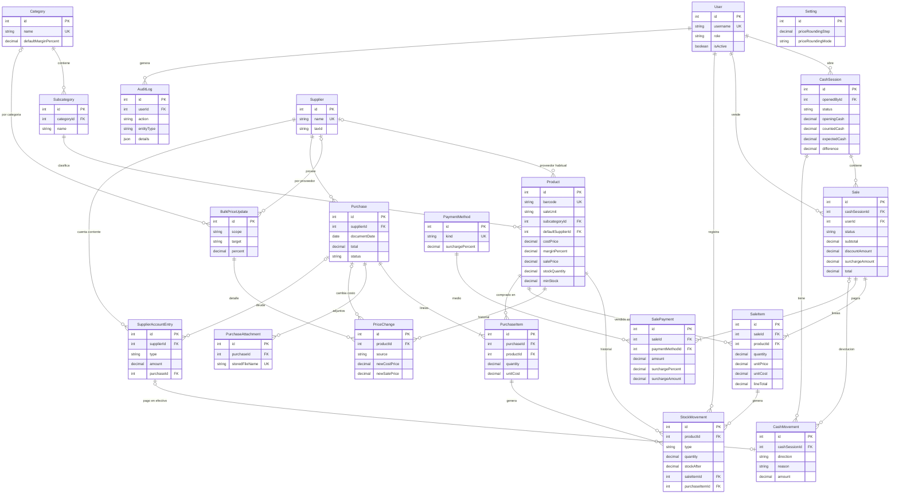

# Modelo de datos – Kiosco (versión 1)

> **Estado:** borrador para aprobación (Fase 2). Basado en `docs/requisitos.md`.
> Los campos o restricciones que dependen de una pregunta abierta están marcados con **PA-xx**. Si la respuesta cambia, se ajusta ese punto antes de crear la migración.
> Base de datos: PostgreSQL. ORM: Prisma. El esquema real (`schema.prisma`) lo escribe el agente `base-datos` a partir de este documento.

---

## 1. Convenciones

### 1.1 Dinero: `Decimal` de Prisma (`numeric(14,2)` en PostgreSQL)

**Decisión:** todo importe de dinero (precios, costos, totales, pagos, saldos) es `Decimal @db.Decimal(14, 2)`: pesos con 2 decimales, hasta 999.999.999.999,99.

**Por qué no centavos enteros:** con la inflación, un total mensual en centavos pasa rápido el límite de `Int` de Prisma (2.147.483.647 centavos = $21 millones), y usar `BigInt` complica el JSON y el código. `numeric` es exacto, se lee directo en la base y en Excel ("1440.00", no "144000"), y Prisma lo maneja con `Prisma.Decimal`.
**Contra:** en el código no se puede usar `+` ni `*` con números de JS: hay que usar los métodos de `Prisma.Decimal` (`.add()`, `.mul()`). Regla para el backend: **nunca convertir dinero a `number`**. Los cálculos intermedios se redondean a 2 decimales con "mitad hacia arriba" (`ROUND_HALF_UP`). Ese redondeo técnico de centavos es distinto del **redondeo comercial de precios** (a $10, PA-19/PA-20), que es una regla de negocio configurable.

### 1.2 Cantidades: `Decimal(12,3)` para todo

**Decisión:** stock y cantidades (ventas, compras, movimientos, mínimos) usan `Decimal @db.Decimal(12, 3)`. Un producto **por unidad** guarda números enteros (`2.000`); uno **por peso** guarda kg con hasta 3 decimales (`0.375` = 375 g).
**Por qué:** un solo tipo para las dos unidades evita tener dos columnas o dos tablas. Que un producto por unidad tenga siempre cantidades enteras lo valida el backend (la base no puede mirar la unidad del producto desde otra tabla con un `CHECK`).

### 1.3 Porcentajes

Márgenes, recargos y aumentos: `Decimal @db.Decimal(6, 2)` (ej.: `40.00` = 40%; máximo 9999,99%).

### 1.4 Otras convenciones

| Tema | Convención |
|---|---|
| Nombres | Modelos Prisma en `PascalCase` singular y campos en `camelCase` (como se listan acá). En PostgreSQL, tablas y columnas en `snake_case` (plural para tablas) usando `@@map` / `@map`. Ej.: `SaleItem.unitPrice` → `sale_items.unit_price`. |
| Claves primarias | `id Int @id @default(autoincrement())`. Alcanza de sobra para un kiosco (miles de millones de filas). El `id` de la venta sirve como **número de venta**. |
| Fechas y horas | `DateTime @db.Timestamptz(3)` (guarda la zona horaria). Los reportes agrupan por día en `America/Argentina/Buenos_Aires` (configurable en `.env`). Fechas sin hora (fecha de factura): `@db.Date`. |
| Creación / modificación | `createdAt` en todas las tablas; `updatedAt` en las que se editan. |
| Borrado lógico | Datos maestros (productos, categorías, subcategorías, proveedores, usuarios, medios de pago) **no se borran**: tienen `isActive`. Las operaciones (ventas, compras) **nunca se borran**: se **anulan** con `status = VOIDED`. |
| Claves foráneas | `onDelete: Restrict` por defecto (no se puede borrar algo que está en uso). Toda columna FK lleva índice (PostgreSQL no lo crea solo). |
| `CHECK` | Prisma no los declara en el esquema: el agente `base-datos` los agrega a mano en el SQL de la migración. Están listados en cada tabla. |
| JSON de la API | Dinero y cantidades viajan como **string** (`"1440.00"`, `"0.375"`) para no perder precisión en JavaScript. El frontend los formatea en es-AR. |
| Enums | `enum` de Prisma para listas cortas y estables. La acción de auditoría es `String` (lista que crece) con su tipo en el código compartido. |

---

## 2. Entidades

Leyenda: **Oblig.** = obligatorio (`NOT NULL`). "→ X" = clave foránea a la tabla X.

### 2.1 `User` (users) — usuarios

| Campo | Tipo | Oblig. | Descripción |
|---|---|:---:|---|
| id | Int | ✅ | Identificador. |
| username | String | ✅ | Nombre de usuario para el login. Se guarda en minúsculas. **Único.** |
| fullName | String | ✅ | Nombre y apellido para mostrar. |
| passwordHash | String | ✅ | Contraseña cifrada con bcrypt. Nunca se devuelve en la API. |
| role | `UserRole` | ✅ | `OWNER` (dueño), `MANAGER` (encargado), `EMPLOYEE` (empleado). |
| isActive | Boolean | ✅ | `false` = desactivado (no puede entrar). Default `true`. |
| tokenVersion | Int | ✅ | Default 0. Se incrementa al cambiar la contraseña o desactivar el usuario, para invalidar sesiones abiertas. (Propuesta para el agente `seguridad`.) |
| lastLoginAt | DateTime | | Último ingreso. |
| createdAt / updatedAt | DateTime | ✅ | |

Restricciones: `UNIQUE(username)`.

### 2.2 `Setting` (settings) — configuración general

Tabla de **una sola fila** (`id = 1`), con columnas tipadas.

| Campo | Tipo | Oblig. | Descripción |
|---|---|:---:|---|
| id | Int | ✅ | Siempre 1. `CHECK (id = 1)`. |
| storeName | String | ✅ | Nombre del negocio. |
| priceRoundingStep | Decimal(14,2) | ✅ | De a cuánto se redondean los precios. Default `10.00`. `0` = sin redondeo. `CHECK (>= 0)`. |
| priceRoundingMode | `RoundingMode` | ✅ | `UP` (hacia arriba) o `NEAREST` (al más cercano). Default pendiente de **PA-19** (propuesto `UP`). |
| updatedAt | DateTime | ✅ | |
| updatedById | Int → User | | Quién la cambió por última vez. |

Los recargos están en `PaymentMethod` y los márgenes en `Category` y `Product`.

### 2.3 `PaymentMethod` (payment_methods) — medios de pago y recargos

| Campo | Tipo | Oblig. | Descripción |
|---|---|:---:|---|
| id | Int | ✅ | |
| kind | `PaymentMethodKind` | ✅ | `CASH`, `TRANSFER`, `QR`, `DEBIT_CARD`, `CREDIT_CARD`. **Único.** El sistema usa `CASH` para calcular la caja. |
| name | String | ✅ | Nombre visible (ej.: "QR Mercado Pago"). |
| surchargePercent | Decimal(6,2) | ✅ | % de recargo. Default 0. `CHECK (>= 0)`. Se carga crédito ≈ 10% en la instalación (valor exacto lo confirma el dueño). |
| isActive | Boolean | ✅ | |
| sortOrder | Int | ✅ | Orden en la pantalla de cobro. |
| updatedAt | DateTime | ✅ | |

Restricciones: `UNIQUE(kind)`. Si se decide recargo por cuotas (**PA-12**), se agrega una tabla de planes de cuotas y esta restricción se revisa.

### 2.4 `Category` (categories) — categorías

| Campo | Tipo | Oblig. | Descripción |
|---|---|:---:|---|
| id | Int | ✅ | |
| name | String | ✅ | Ej.: "Bebidas". **Único.** |
| defaultMarginPercent | Decimal(6,2) | ✅ | Margen que usan los productos sin margen propio. `CHECK (>= 0)`. |
| isActive | Boolean | ✅ | |
| createdAt / updatedAt | DateTime | ✅ | |

### 2.5 `Subcategory` (subcategories) — subcategorías

| Campo | Tipo | Oblig. | Descripción |
|---|---|:---:|---|
| id | Int | ✅ | |
| categoryId | Int → Category | ✅ | Categoría a la que pertenece. |
| name | String | ✅ | Ej.: "Gaseosas". |
| isActive | Boolean | ✅ | |
| createdAt / updatedAt | DateTime | ✅ | |

Restricciones: `UNIQUE(categoryId, name)` (sirve también como índice de `categoryId`).

### 2.6 `Supplier` (suppliers) — proveedores

| Campo | Tipo | Oblig. | Descripción |
|---|---|:---:|---|
| id | Int | ✅ | |
| name | String | ✅ | **Único.** |
| phone | String | | Teléfono / WhatsApp (se guarda solo con dígitos, con código de país, para armar el link de WhatsApp). |
| email | String | | |
| taxId | String | | CUIT, 11 dígitos sin guiones. `CHECK (tax_id ~ '^[0-9]{11}$')`. |
| visitDays | `Weekday[]` | ✅ | Días de visita (`MON`…`SUN`). Default lista vacía. |
| notes | String | | |
| isActive | Boolean | ✅ | |
| createdAt / updatedAt | DateTime | ✅ | |

El **saldo** de la cuenta corriente no se guarda acá: se calcula sumando `SupplierAccountEntry` (ver 2.19).

### 2.7 `Product` (products) — productos

| Campo | Tipo | Oblig. | Descripción |
|---|---|:---:|---|
| id | Int | ✅ | |
| name | String | ✅ | Nombre para buscar y mostrar. |
| barcode | String | | Código de barras. **Único** cuando existe (varios productos pueden no tener). Uno por producto: **PA-11**. |
| saleUnit | `SaleUnit` | ✅ | `UNIT` (por unidad) o `KG` (por peso). |
| subcategoryId | Int → Subcategory | ✅ | Subcategoría fija. La categoría sale de la subcategoría. |
| defaultSupplierId | Int → Supplier | | Proveedor habitual (para pedido sugerido y aumentos por proveedor). **PA-04**. |
| costPrice | Decimal(14,2) | ✅ | Costo actual por unidad o por kg. Default 0. `CHECK (>= 0)`. |
| marginPercent | Decimal(6,2) | | Margen propio. `NULL` = usa el de la categoría. `CHECK (>= 0)`. |
| salePrice | Decimal(14,2) | ✅ | Precio de venta actual (por unidad o por kg). Se **guarda**, no se calcula al vuelo: el margen solo sirve para **sugerir** (PA-21). `CHECK (>= 0)`. |
| stockQuantity | Decimal(12,3) | ✅ | Stock actual. **Puede ser negativo** (R2). Default 0. Es un resumen de `StockMovement` (ver decisión D4). |
| minStock | Decimal(12,3) | ✅ | Stock mínimo. Default 0. `CHECK (>= 0)`. |
| isActive | Boolean | ✅ | |
| createdAt / updatedAt | DateTime | ✅ | |

Restricciones e índices:
- `UNIQUE(barcode)` (PostgreSQL permite varios `NULL`).
- Índices: `subcategoryId`, `defaultSupplierId`.
- Búsqueda por nombre: al principio `ILIKE` alcanza (pocos miles de productos). Si se vuelve lento, índice de trigramas (`pg_trgm`) sobre `lower(name)` y búsqueda sin acentos (`unaccent`).
- "Para reponer": `stockQuantity <= minStock` (PA-26) sobre productos activos; con este volumen no necesita índice especial.

### 2.8 `StockMovement` (stock_movements) — historial de stock

Cada cambio de stock es una fila. **Nunca se edita ni se borra.**

| Campo | Tipo | Oblig. | Descripción |
|---|---|:---:|---|
| id | Int | ✅ | |
| productId | Int → Product | ✅ | |
| type | `StockMovementType` | ✅ | `SALE`, `SALE_VOID`, `PURCHASE`, `PURCHASE_VOID`, `ADJUSTMENT`. |
| quantity | Decimal(12,3) | ✅ | Con signo: `+` entra, `−` sale. `CHECK (quantity <> 0)`. |
| stockAfter | Decimal(12,3) | ✅ | Stock que quedó después del movimiento (facilita revisar el historial). |
| unitCost | Decimal(14,2) | | Costo del producto en ese momento (para valorizar roturas o faltantes). |
| adjustmentReason | `StockAdjustmentReason` | | Solo en ajustes: `BREAKAGE`, `MISSING`, `COUNT_CORRECTION`, `INITIAL_LOAD`, `OTHER` (lista: **PA-27**). |
| note | String | | Obligatoria si el motivo es `OTHER`. |
| saleItemId | Int → SaleItem | | Línea de venta que lo generó (venta o anulación). |
| purchaseItemId | Int → PurchaseItem | | Línea de compra que lo generó (compra o anulación). |
| userId | Int → User | ✅ | Quién lo hizo. |
| createdAt | DateTime | ✅ | |

`CHECK`s:
- `type = 'ADJUSTMENT'` ⇔ `adjustment_reason IS NOT NULL`.
- `type IN ('SALE','SALE_VOID')` ⇒ `sale_item_id IS NOT NULL`; `type IN ('PURCHASE','PURCHASE_VOID')` ⇒ `purchase_item_id IS NOT NULL`.
- `SALE` y `PURCHASE_VOID` con `quantity < 0`; `SALE_VOID` y `PURCHASE` con `quantity > 0`.

Índices: `(productId, createdAt)` (historial de un producto), `createdAt`, `saleItemId`, `purchaseItemId`, `userId`.

### 2.9 `PriceChange` (price_changes) — historial de costos y precios

Se crea una fila cada vez que cambia el costo, el precio o el margen de un producto.

| Campo | Tipo | Oblig. | Descripción |
|---|---|:---:|---|
| id | Int | ✅ | |
| productId | Int → Product | ✅ | |
| source | `PriceChangeSource` | ✅ | `MANUAL`, `PURCHASE`, `BULK_UPDATE`. |
| oldCostPrice / newCostPrice | Decimal(14,2) | ✅ | |
| oldSalePrice / newSalePrice | Decimal(14,2) | ✅ | |
| oldMarginPercent / newMarginPercent | Decimal(6,2) | | `NULL` = usaba / usa el de la categoría. |
| purchaseId | Int → Purchase | | Si vino de una compra. |
| bulkPriceUpdateId | Int → BulkPriceUpdate | | Si vino de un aumento masivo. |
| userId | Int → User | ✅ | |
| createdAt | DateTime | ✅ | |

`CHECK`: `source = 'PURCHASE'` ⇒ `purchase_id IS NOT NULL`; `source = 'BULK_UPDATE'` ⇒ `bulk_price_update_id IS NOT NULL`.
Índices: `(productId, createdAt)`, `createdAt`, `purchaseId`, `bulkPriceUpdateId`.

### 2.10 `BulkPriceUpdate` (bulk_price_updates) — aumentos masivos

Cabecera de cada aumento masivo; el detalle por producto queda en `PriceChange`.

| Campo | Tipo | Oblig. | Descripción |
|---|---|:---:|---|
| id | Int | ✅ | |
| scope | `BulkUpdateScope` | ✅ | `SUPPLIER` o `CATEGORY`. |
| supplierId | Int → Supplier | | Obligatorio si `scope = SUPPLIER`. |
| categoryId | Int → Category | | Obligatorio si `scope = CATEGORY`. |
| target | `BulkUpdateTarget` | ✅ | `COST` (sube el costo y recalcula el precio) o `SALE_PRICE` (sube el precio). **PA-23**. |
| percent | Decimal(6,2) | ✅ | `CHECK (percent > 0)` (solo aumentos, R4; revisar si PA-23 habilita bajas). |
| productsAffected | Int | ✅ | Cantidad de productos modificados. |
| userId | Int → User | ✅ | |
| createdAt | DateTime | ✅ | |

`CHECK`: `(scope = 'SUPPLIER' AND supplier_id IS NOT NULL AND category_id IS NULL) OR (scope = 'CATEGORY' AND category_id IS NOT NULL AND supplier_id IS NULL)`.

### 2.11 `CashSession` (cash_sessions) — caja por turno

| Campo | Tipo | Oblig. | Descripción |
|---|---|:---:|---|
| id | Int | ✅ | |
| openedById | Int → User | ✅ | Quién abrió (dueño del turno). |
| openedAt | DateTime | ✅ | |
| openingCash | Decimal(14,2) | ✅ | Efectivo inicial. `CHECK (>= 0)`. |
| status | `CashSessionStatus` | ✅ | `OPEN` o `CLOSED`. |
| closedById | Int → User | | Quién cerró. |
| closedAt | DateTime | | |
| countedCash | Decimal(14,2) | | Efectivo contado (cierre a ciegas). |
| expectedCash | Decimal(14,2) | | Efectivo esperado, **calculado y guardado al cerrar** (foto fija). |
| difference | Decimal(14,2) | | `countedCash − expectedCash`. Negativo = faltante. La API solo lo muestra a encargado y dueño. |
| closingNote | String | | Nota del cierre. |
| createdAt / updatedAt | DateTime | ✅ | |

`CHECK`: si `status = 'CLOSED'` ⇒ `closed_at`, `closed_by_id`, `counted_cash`, `expected_cash` y `difference` no nulos; si `OPEN` ⇒ todos nulos.

Cálculo al cerrar (dentro de una transacción):
`expectedCash = openingCash + Σ pagos en efectivo de las ventas de esta caja (amount + surchargeAmount) + Σ CashMovement IN − Σ CashMovement OUT`.
Las ventas anuladas **siguen contando** acá: la devolución del efectivo se registra como `CashMovement` de salida (motivo `SALE_VOID_REFUND`) en la caja abierta al momento de anular. Así una caja cerrada nunca cambia (PA-17).

Índices:
- Índice único parcial según **PA-02** (en SQL de la migración):
  - Opción recomendada (una sola caja abierta): `CREATE UNIQUE INDEX ON cash_sessions ((true)) WHERE status = 'OPEN';`
  - Alternativa (una por usuario): `CREATE UNIQUE INDEX ON cash_sessions (opened_by_id) WHERE status = 'OPEN';`
- `(openedById, openedAt)`, `openedAt`.

### 2.12 `CashMovement` (cash_movements) — ingresos y salidas de efectivo

| Campo | Tipo | Oblig. | Descripción |
|---|---|:---:|---|
| id | Int | ✅ | |
| cashSessionId | Int → CashSession | ✅ | Caja abierta en la que se registró. |
| direction | `CashDirection` | ✅ | `IN` (ingreso) u `OUT` (salida). |
| reason | `CashMovementReason` | ✅ | `SUPPLIER_PAYMENT`, `OWNER_WITHDRAWAL`, `EXPENSE`, `CASH_CONTRIBUTION`, `SALE_VOID_REFUND`, `OTHER` (lista: **PA-29**). |
| description | String | ✅ | Detalle escrito por el usuario (ej.: "Pago luz"). |
| amount | Decimal(14,2) | ✅ | Siempre positivo; el sentido lo da `direction`. `CHECK (amount > 0)`. |
| supplierAccountEntryId | Int → SupplierAccountEntry | | Si es un pago a proveedor. **Único.** |
| saleId | Int → Sale | | Si es la devolución de una venta anulada. |
| userId | Int → User | ✅ | Quién lo registró. |
| createdAt | DateTime | ✅ | |

`CHECK`: `reason = 'SUPPLIER_PAYMENT'` ⇒ `direction = 'OUT' AND supplier_account_entry_id IS NOT NULL`; `reason = 'SALE_VOID_REFUND'` ⇒ `direction = 'OUT' AND sale_id IS NOT NULL`.
Índices: `cashSessionId`, `createdAt`, `saleId`, `userId`; `UNIQUE(supplierAccountEntryId)`.

### 2.13 `Sale` (sales) — ventas

| Campo | Tipo | Oblig. | Descripción |
|---|---|:---:|---|
| id | Int | ✅ | También es el **número de venta**. |
| cashSessionId | Int → CashSession | ✅ | Caja en la que se cobró (PA-02). |
| userId | Int → User | ✅ | Quién vendió. |
| status | `SaleStatus` | ✅ | `COMPLETED` o `VOIDED` (anulada). |
| subtotal | Decimal(14,2) | ✅ | Suma de `lineSubtotal` de las líneas. |
| discountAmount | Decimal(14,2) | ✅ | Descuento manual en $. Default 0. |
| discountPercent | Decimal(6,2) | | Si el descuento se cargó en %, el % usado (informativo). PA-15. |
| discountReason | String | | Motivo del descuento (opcional). |
| surchargeAmount | Decimal(14,2) | ✅ | Suma de recargos de los pagos. Default 0. |
| total | Decimal(14,2) | ✅ | Lo cobrado: `subtotal − discountAmount + surchargeAmount`. |
| voidedAt | DateTime | | |
| voidedById | Int → User | | Quién anuló (encargado o dueño). |
| voidReason | String | | Motivo de la anulación. |
| createdAt | DateTime | ✅ | Fecha y hora de la venta. |

`CHECK`s:
- `discount_amount >= 0 AND discount_amount <= subtotal`, `surcharge_amount >= 0`.
- `total = subtotal - discount_amount + surcharge_amount`.
- `status = 'VOIDED'` ⇔ (`voided_at`, `voided_by_id` y `void_reason` no nulos).

Índices: `createdAt` (reportes por fecha), `cashSessionId`, `(userId, createdAt)`, `voidedById`.

### 2.14 `SaleItem` (sale_items) — líneas de venta (con "foto" de precio y costo)

| Campo | Tipo | Oblig. | Descripción |
|---|---|:---:|---|
| id | Int | ✅ | |
| saleId | Int → Sale | ✅ | |
| productId | Int → Product | ✅ | |
| productName | String | ✅ | Nombre del producto **al momento de la venta**. |
| saleUnit | `SaleUnit` | ✅ | Unidad al momento de la venta. |
| quantity | Decimal(12,3) | ✅ | `CHECK (quantity > 0)`. |
| unitPrice | Decimal(14,2) | ✅ | Precio de venta **congelado** al vender. |
| unitCost | Decimal(14,2) | ✅ | Costo **congelado** al vender (para la ganancia histórica). |
| lineSubtotal | Decimal(14,2) | ✅ | `quantity × unitPrice`, redondeado (PA-20). |
| discountAmount | Decimal(14,2) | ✅ | Parte del descuento de la venta que le toca a esta línea (reparto proporcional; ver D6). Default 0. |
| lineTotal | Decimal(14,2) | ✅ | `lineSubtotal − discountAmount`. |

`CHECK`s: `unit_price >= 0`, `unit_cost >= 0`, `discount_amount >= 0`, `line_total = line_subtotal - discount_amount`.
Índices: `saleId`, `productId`.
Ganancia de la línea = `lineTotal − quantity × unitCost`.

### 2.15 `SalePayment` (sale_payments) — pagos de la venta (pago mixto)

Una venta tiene **uno o más** pagos.

| Campo | Tipo | Oblig. | Descripción |
|---|---|:---:|---|
| id | Int | ✅ | |
| saleId | Int → Sale | ✅ | |
| paymentMethodId | Int → PaymentMethod | ✅ | |
| amount | Decimal(14,2) | ✅ | Parte de la venta que cubre este pago, **sin** recargo. `CHECK (amount > 0)`. |
| surchargePercent | Decimal(6,2) | ✅ | % de recargo **congelado** del medio de pago al vender. |
| surchargeAmount | Decimal(14,2) | ✅ | Recargo de este pago. `CHECK (>= 0)`. Base del cálculo: PA-14. |

Lo cobrado con este medio = `amount + surchargeAmount`.
Reglas que valida el backend dentro de la transacción (no se pueden expresar con `CHECK` porque cruzan filas): `Σ amount = sale.subtotal − sale.discountAmount` y `Σ surchargeAmount = sale.surchargeAmount`.
Índices: `saleId`, `paymentMethodId`.

### 2.16 `Purchase` (purchases) — compras

| Campo | Tipo | Oblig. | Descripción |
|---|---|:---:|---|
| id | Int | ✅ | |
| supplierId | Int → Supplier | ✅ | |
| documentType | `PurchaseDocumentType` | ✅ | `INVOICE` (factura), `DELIVERY_NOTE` (remito), `OTHER`. |
| documentNumber | String | | Número de factura/remito. |
| documentDate | Date | ✅ | Fecha del comprobante. |
| total | Decimal(14,2) | ✅ | Suma de `lineTotal` de las líneas (más "otros cargos" si se decide en PA-24). `CHECK (>= 0)`. |
| notes | String | | |
| status | `PurchaseStatus` | ✅ | `CONFIRMED` o `VOIDED` (PA-25). |
| userId | Int → User | ✅ | Quién la cargó. |
| voidedAt / voidedById / voidReason | | | Igual que en `Sale`. |
| createdAt | DateTime | ✅ | |

`CHECK`: `status = 'VOIDED'` ⇔ campos de anulación no nulos.
Índices: `(supplierId, documentDate)`, `documentDate`, `(supplierId, documentNumber)` (para **avisar** si se carga dos veces la misma factura; no es único porque los remitos pueden repetir número).

### 2.17 `PurchaseItem` (purchase_items) — líneas de compra

| Campo | Tipo | Oblig. | Descripción |
|---|---|:---:|---|
| id | Int | ✅ | |
| purchaseId | Int → Purchase | ✅ | |
| productId | Int → Product | ✅ | |
| quantity | Decimal(12,3) | ✅ | En unidad de venta o kg (PA-06). `CHECK (> 0)`. |
| unitCost | Decimal(14,2) | ✅ | Costo por unidad o kg en esta compra. `CHECK (>= 0)`. |
| previousCostPrice | Decimal(14,2) | ✅ | Costo que tenía el producto antes de esta compra (para mostrar "subió X%"). |
| lineTotal | Decimal(14,2) | ✅ | `quantity × unitCost`. |

Índices: `purchaseId`, `productId`.

### 2.18 `PurchaseAttachment` (purchase_attachments) — fotos/archivos de la factura

Los archivos se guardan **en disco** (carpeta configurada en `.env`, `UPLOADS_DIR`), no dentro de la base. La tabla guarda los datos para encontrarlos.

| Campo | Tipo | Oblig. | Descripción |
|---|---|:---:|---|
| id | Int | ✅ | |
| purchaseId | Int → Purchase | ✅ | |
| originalFileName | String | ✅ | Nombre con el que se subió. |
| storedFileName | String | ✅ | Nombre generado por el sistema (aleatorio, sin datos del usuario). **Único.** |
| mimeType | String | ✅ | `image/jpeg`, `image/png` o `application/pdf`. |
| sizeBytes | Int | ✅ | `CHECK (size_bytes > 0)`. Máximo configurable (propuesto 10 MB). |
| uploadedById | Int → User | ✅ | |
| createdAt | DateTime | ✅ | |

Índices: `purchaseId`; `UNIQUE(storedFileName)`. Las copias de seguridad incluyen esta carpeta.

### 2.19 `SupplierAccountEntry` (supplier_account_entries) — cuenta corriente con proveedores

Cada fila es un movimiento "debe/haber" con un proveedor. **Saldo = suma de `amount`**: positivo = le debemos.

| Campo | Tipo | Oblig. | Descripción |
|---|---|:---:|---|
| id | Int | ✅ | |
| supplierId | Int → Supplier | ✅ | |
| type | `SupplierEntryType` | ✅ | `PURCHASE` (suma deuda), `PAYMENT` (pago), `PURCHASE_VOID` (anulación de compra), `ADJUSTMENT` (corrección). |
| amount | Decimal(14,2) | ✅ | Con signo: `+` aumenta la deuda, `−` la reduce. `CHECK (amount <> 0)`. |
| entryDate | Date | ✅ | Fecha del movimiento (fecha de factura o de pago). |
| purchaseId | Int → Purchase | | Para `PURCHASE` y `PURCHASE_VOID`. |
| paymentSource | `SupplierPaymentSource` | | Solo pagos: `CASH_REGISTER` (efectivo de la caja: genera `CashMovement`), `CASH_OUTSIDE_REGISTER`, `BANK_TRANSFER`, `OTHER`. **PA-08**. |
| reference | String | | Ej.: número de transferencia. |
| description | String | | |
| userId | Int → User | ✅ | |
| createdAt | DateTime | ✅ | |

`CHECK`s:
- `PURCHASE`: `amount > 0 AND purchase_id IS NOT NULL`.
- `PURCHASE_VOID`: `amount < 0 AND purchase_id IS NOT NULL`.
- `PAYMENT`: `amount < 0 AND payment_source IS NOT NULL`.
- `payment_source IS NULL` si `type <> 'PAYMENT'`.

Restricciones e índices: `UNIQUE(purchaseId, type)` (una deuda y como mucho una anulación por compra), `(supplierId, entryDate)`, `userId`.

### 2.20 `AuditLog` (audit_logs) — auditoría

Registro de acciones sensibles. **Solo se agregan filas**; el sistema no ofrece editarlas ni borrarlas.

| Campo | Tipo | Oblig. | Descripción |
|---|---|:---:|---|
| id | Int | ✅ | |
| userId | Int → User | | Quién (vacío en un login fallido con usuario inexistente). |
| action | String | ✅ | Ej.: `SALE_VOID`, `STOCK_ADJUST`, `PRICE_CHANGE`, `BULK_PRICE_UPDATE`, `CASH_SESSION_CLOSE`, `CASH_MOVEMENT_OUT`, `CASH_MOVEMENT_IN`, `PURCHASE_VOID`, `DISCOUNT_APPLIED`, `LOGIN`, `LOGIN_FAILED`, `USER_CREATE`, `USER_UPDATE`, `SETTINGS_UPDATE`. La lista vive en el código compartido. |
| entityType | String | ✅ | Tabla afectada (ej.: `Sale`). |
| entityId | String | | Id del registro afectado. |
| details | Json | | Valores antes/después y datos útiles (ej.: motivo). Nunca contraseñas ni tokens. |
| ipAddress | String | | IP de origen (permite distinguir accesos por el túnel remoto). |
| createdAt | DateTime | ✅ | |

Índices: `createdAt`, `(userId, createdAt)`, `(entityType, entityId)`.
Propuesta para `seguridad`: el usuario de base de datos de la aplicación puede tener quitado el permiso `UPDATE/DELETE` sobre esta tabla.

### 2.21 Enums

| Enum | Valores |
|---|---|
| `UserRole` | `OWNER`, `MANAGER`, `EMPLOYEE` |
| `RoundingMode` | `UP`, `NEAREST` |
| `PaymentMethodKind` | `CASH`, `TRANSFER`, `QR`, `DEBIT_CARD`, `CREDIT_CARD` |
| `SaleUnit` | `UNIT`, `KG` |
| `Weekday` | `MON`, `TUE`, `WED`, `THU`, `FRI`, `SAT`, `SUN` |
| `StockMovementType` | `SALE`, `SALE_VOID`, `PURCHASE`, `PURCHASE_VOID`, `ADJUSTMENT` |
| `StockAdjustmentReason` | `BREAKAGE`, `MISSING`, `COUNT_CORRECTION`, `INITIAL_LOAD`, `OTHER` (PA-27) |
| `PriceChangeSource` | `MANUAL`, `PURCHASE`, `BULK_UPDATE` |
| `BulkUpdateScope` | `SUPPLIER`, `CATEGORY` |
| `BulkUpdateTarget` | `COST`, `SALE_PRICE` (PA-23) |
| `CashSessionStatus` | `OPEN`, `CLOSED` |
| `CashDirection` | `IN`, `OUT` |
| `CashMovementReason` | `SUPPLIER_PAYMENT`, `OWNER_WITHDRAWAL`, `EXPENSE`, `CASH_CONTRIBUTION`, `SALE_VOID_REFUND`, `OTHER` (PA-29) |
| `SaleStatus` | `COMPLETED`, `VOIDED` |
| `PurchaseDocumentType` | `INVOICE`, `DELIVERY_NOTE`, `OTHER` |
| `PurchaseStatus` | `CONFIRMED`, `VOIDED` |
| `SupplierEntryType` | `PURCHASE`, `PAYMENT`, `PURCHASE_VOID`, `ADJUSTMENT` |
| `SupplierPaymentSource` | `CASH_REGISTER`, `CASH_OUTSIDE_REGISTER`, `BANK_TRANSFER`, `OTHER` (PA-08) |

---

## 3. Diagrama entidad-relación

Se muestran solo las claves y los campos principales; el detalle está en la sección 2.

---

## 4. Cómo se usan juntas las tablas (operaciones clave)

Cada operación se hace en **una sola transacción** (todo o nada, NF-11).

**Venta**
1. Verificar que hay caja abierta (PA-02).
2. Crear `Sale` + `SaleItem` (con precio, costo y nombre congelados) + `SalePayment` (con % de recargo congelado).
3. Por cada línea: `StockMovement` tipo `SALE` (cantidad negativa) y actualizar `Product.stockQuantity`. Si queda negativo, se permite (el aviso se mostró antes de confirmar).
4. Si hubo descuento: `AuditLog` `DISCOUNT_APPLIED`.

**Anulación de venta**
1. `Sale.status = VOIDED` + quién, cuándo y motivo.
2. Por cada línea: `StockMovement` tipo `SALE_VOID` (cantidad positiva).
3. Si tuvo pagos en efectivo: `CashMovement` `OUT` / `SALE_VOID_REFUND` en la caja abierta actual (PA-17).
4. `AuditLog` `SALE_VOID`.

**Compra**
1. Crear `Purchase` + `PurchaseItem` (con costo anterior) + `PurchaseAttachment`.
2. Por cada línea: `StockMovement` `PURCHASE` y, si el costo cambió, actualizar `Product.costPrice` (PA-05) y crear `PriceChange` (`source = PURCHASE`). Si el usuario confirmó un precio nuevo, también se actualiza `salePrice` en el mismo `PriceChange`.
3. `SupplierAccountEntry` `PURCHASE` por el total (PA-07).

**Pago a proveedor**
1. `SupplierAccountEntry` `PAYMENT` (monto negativo).
2. Si `paymentSource = CASH_REGISTER`: `CashMovement` `OUT` / `SUPPLIER_PAYMENT` vinculado, en la caja abierta.

**Cierre de caja**
1. Calcular y guardar `expectedCash`, `countedCash`, `difference`; `status = CLOSED`.
2. `AuditLog` `CASH_SESSION_CLOSE`.

**Aumento masivo**
1. Crear `BulkPriceUpdate`.
2. Por cada producto del proveedor o categoría: actualizar costo y/o precio y crear `PriceChange` (`source = BULK_UPDATE`).
3. `AuditLog` `BULK_PRICE_UPDATE`.

---

## 5. Lo que queda preparado para el futuro (sin implementarlo)

### 5.1 Facturación electrónica ARCA
- Las ventas ya guardan importes exactos, fecha, líneas y pagos: es lo que necesita un comprobante.
- Se agregaría una tabla `FiscalDocument` (comprobante) vinculada a `Sale`: tipo (Factura B/C, nota de crédito), punto de venta, número, CAE y vencimiento, datos del comprador si hace falta (Factura A), estado del envío y respuesta de ARCA. **No hay que tocar `Sale`.**
- Una anulación de venta facturada generaría una nota de crédito (otra fila de `FiscalDocument`).
- `Setting` sumaría CUIT, condición frente al IVA y punto de venta; `Product` una alícuota de IVA si el kiosco es responsable inscripto (PA-13).
- Como no hay clientes registrados (R5), los datos del comprador se guardarían en el comprobante y no en una tabla de clientes.

### 5.2 Varias sucursales
- Se agregaría una tabla `Branch` y una columna `branchId` en `CashSession`, `Sale`, `Purchase` y `StockMovement` (una migración con valor por defecto = sucursal actual).
- El stock pasaría de `Product.stockQuantity` a una tabla `ProductStock(branchId, productId)`. Como **todo cambio de stock pasa por `StockMovement` y por un único servicio del backend**, el cambio queda en un solo lugar.
- Precios, productos y proveedores pueden seguir siendo comunes.
- No se agrega nada de esto ahora: sería complejidad sin uso (una sola sucursal, R6).

### 5.3 Acceso remoto
- El acceso remoto del dueño (R6) **no cambia el modelo de datos**: es un túnel seguro hacia el mismo servidor. Solo se aprovechan `AuditLog.ipAddress` (ver desde dónde se entró) y `User.tokenVersion` (cerrar sesiones si se pierde el celular).

---

## 6. Decisiones de diseño

| # | Decisión | Por qué | En contra / cuidado |
|---|---|---|---|
| D1 | **Dinero en `Decimal(14,2)`**, no centavos enteros. | Exacto, legible en la base y en Excel, sin el límite de `Int` que la inflación haría alcanzable. | Hay que usar `Prisma.Decimal` en el backend y mandar strings en el JSON. |
| D2 | **Cantidades en `Decimal(12,3)`** para unidad y kg. | Un solo tipo para los dos casos; gramos de precisión. | El backend valida que los productos por unidad tengan cantidades enteras. |
| D3 | **Ids `Int` autoincrementales.** | Lo más simple; el id de la venta es su número. | Si algún día hay sincronización entre sucursales con bases separadas, habría que pasar a UUID (no previsto). |
| D4 | **Stock = historial de movimientos + número actual guardado en el producto.** Los dos se actualizan en la misma transacción. | El historial explica cada cambio (auditoría); el número guardado hace que la venta y las listas sean rápidas sin sumar miles de filas. | Si alguien tocara la base a mano podrían desincronizarse; se puede agregar un chequeo que compare la suma de movimientos con el stock. |
| D5 | **"Foto" de precio, costo, nombre y % de recargo en cada venta.** | Cambiar precios o recargos no altera ventas pasadas ni la ganancia histórica. | Algo de datos repetidos (es intencional). |
| D6 | **El descuento de la venta se reparte entre las líneas** (`SaleItem.discountAmount`) al guardar, proporcional al importe de cada una; el centavo de diferencia va a la última línea. | El reporte de ganancia por categoría queda exacto con una suma simple. | Un cálculo más al guardar la venta. |
| D7 | **El precio de venta se guarda**; el margen solo sugiere. | Así el usuario confirma el precio (R3) y lo puede ajustar a mano. | Si el costo cambia por fuera de una compra, el precio no se actualiza solo (es lo pedido: el usuario confirma). |
| D8 | **Cada producto guarda solo la subcategoría**; la categoría se obtiene a través de ella. | Imposible que un producto tenga una subcategoría de otra categoría. | Los reportes por categoría necesitan un join más (trivial). Si se mueve un producto de categoría, los reportes viejos lo muestran en la nueva (aceptable; se puede congelar la categoría en la venta si hiciera falta). |
| D9 | **Las cajas cerradas no se modifican.** La devolución de una venta anulada es una salida de la caja abierta. | El arqueo de cada turno queda fijo y confiable. | Depende de PA-17. |
| D10 | **Cuenta corriente con proveedores como lista de movimientos con signo**; el saldo se calcula. | Nunca hay un saldo que no coincida con su historial. | Calcular el saldo es una suma; con este volumen no importa. |
| D11 | **Adjuntos en disco**, no en la base. | La base queda chica y rápida; los archivos se abren directo. | El backup tiene que incluir la carpeta (NF-04). |
| D12 | **Configuración general en una tabla de una sola fila** con columnas tipadas; recargos en `PaymentMethod`, márgenes en `Category`. | Cada dato tiene su tipo y validación; nada de texto libre "clave = valor". | Agregar un ajuste nuevo requiere una migración (es sencilla). |
| D13 | **Borrado lógico (`isActive`) en datos maestros; anulación (`VOIDED`) en operaciones.** | No se pierde historial ni se rompen reportes viejos. | Las búsquedas deben filtrar por activos. |
| D14 | **Auditoría en una tabla aparte, solo de agregado**, además del historial propio de stock, precios y caja. | Un único lugar para ver "quién hizo qué" en acciones sensibles. | Algunos datos quedan repetidos (en el historial del módulo y en la auditoría). |
| D15 | **Sin tablas de clientes, pedidos a proveedores ni sucursales.** | No hay fiado (R5); los pedidos solo generan un texto (PA-26); hay una sola sucursal (R6). | Si cambian esas respuestas se agregan después. |
| D16 | **Restricciones `CHECK` e índices parciales escritos a mano en la migración.** | Protegen los datos aunque haya un error en el backend. | Prisma no los muestra en `schema.prisma`: hay que documentarlos en la migración. |
